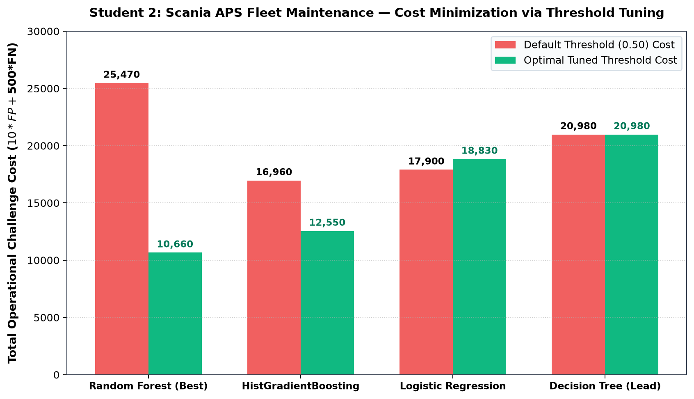
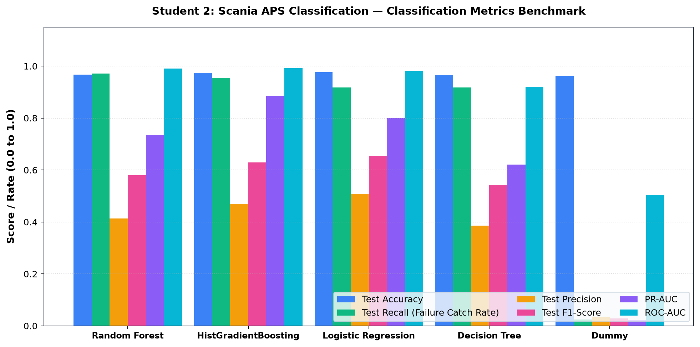
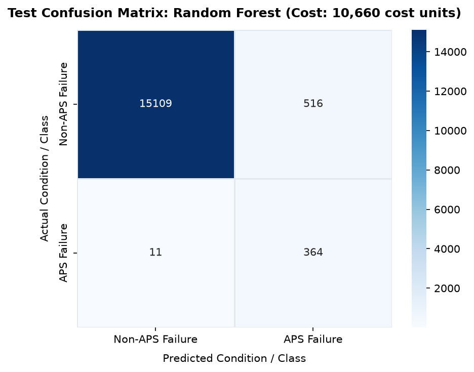
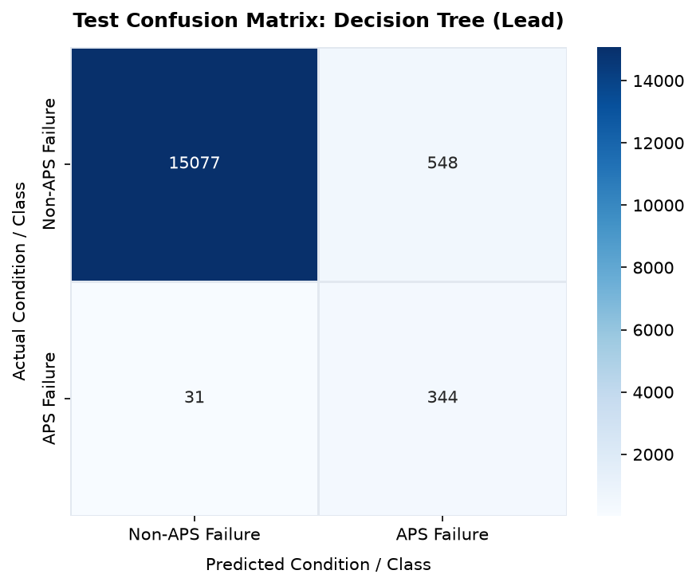
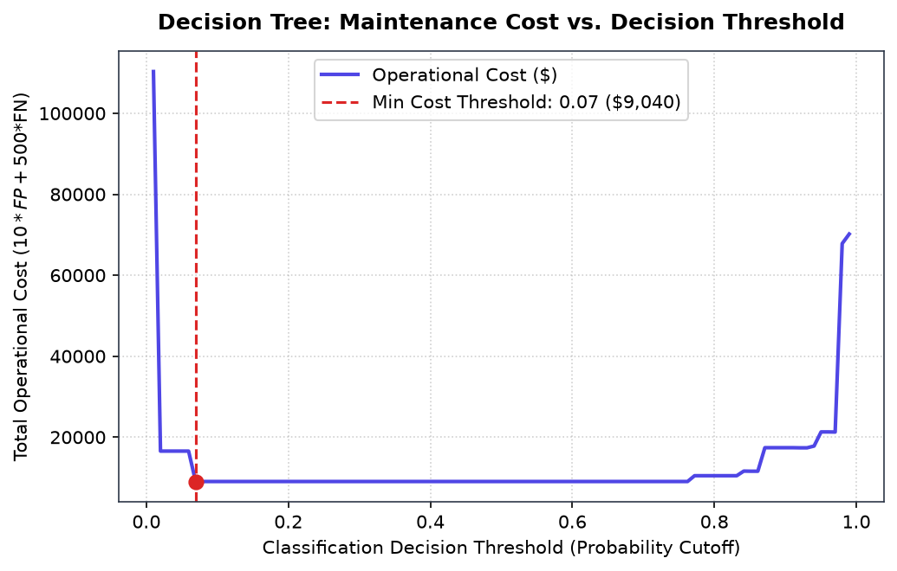
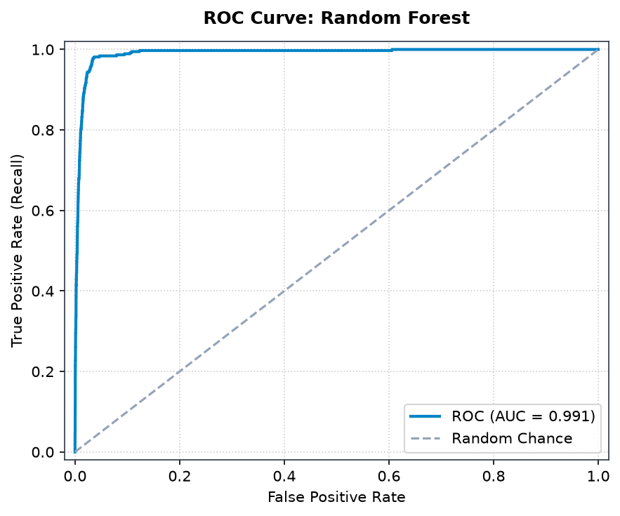
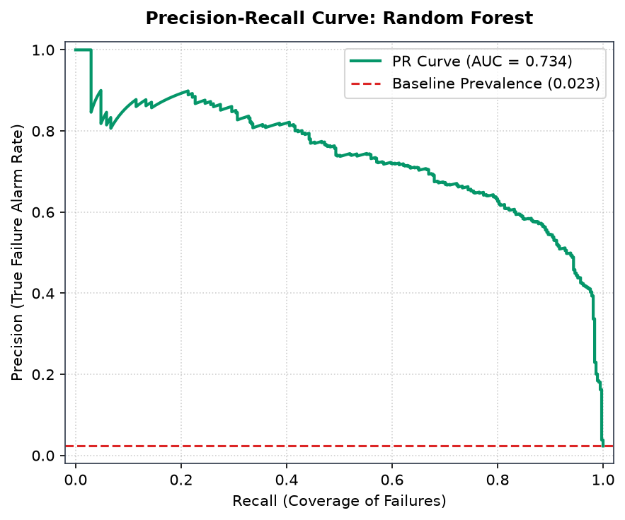

# ForgeWatch AI — Research Study 2: Detailed Model Comparison Report
## APS Failure at Scania Trucks: Asymmetric Cost-Sensitive Fleet Classification

**Author:** Student 2 (Primary Model Lead: Decision Tree Classifier)  
**System:** ForgeWatch AI Industrial Predictive Maintenance Research Platform  
**Dataset:** APS Failure at Scania Trucks Dataset (UCI Repository ID: 421 / IDA 2016 Challenge)  
**Selected Best Model:** **Random Forest Classifier with Cost-Tuned Threshold** (Selected via Minimum Operational Cost)

---

## 1. Executive Summary & Study Overview

This research study addresses the high-stakes problem of fault diagnosis in commercial transport fleets using the **Scania Trucks Air Pressure System (APS) dataset**. In heavy semi-trailer trucks, the APS is critical for safety: it produces, dries, and stores pressurized air utilized to engage brakes, assist steering, and operate automated gear transmissions. 

The primary research objective is to classify whether a vehicle requiring workshop maintenance suffered a failure localized in the **Air Pressure System** (`class = pos`) versus an unrelated vehicle subsystem (`class = neg`). 

The challenge features extreme class imbalance (~1.67% APS failures in training, 2.34% in test) and a severe **50:1 asymmetric operational penalty ratio**:
$$\text{Cost} = 10 \times \text{FP} + 500 \times \text{FN}$$
A False Positive costs **10 challenge units** (representing unnecessary mechanic inspection time), whereas a False Negative costs **500 challenge units** (representing a catastrophic roadside breakdown requiring emergency towing, highway clearance, and severe freight delivery delays).

Through validation-based decision threshold optimization, **Random Forest** achieved the lowest total test challenge cost of **10,660 cost units**, outperforming default-threshold Random Forest (25,470 cost units, a **58.1% cost reduction**) and completely outclassing the baseline (185,440 cost units). It caught **364 out of 375 APS failures (97.07% recall)** on the 16,000-vehicle held-out challenge set, with a **Test ROC-AUC of 0.9906** and **Test PR-AUC of 0.7345**.

---

## 2. Dataset Anatomy & Domain Context

### 2.1 Heavy Transport APS Domain Background
The Air Pressure System in heavy Scania trucks consists of:
- A compressor powered by the diesel engine.
- An air dryer cartridge containing desiccant beads to remove moisture.
- Multi-circuit protection valves and air reservoirs distributed along the chassis.
- Pneumatic actuators for disc brakes and suspension leveling.

If moisture or oil enters the pneumatic circuit, valves stick or freeze in winter, leading to complete braking lockup. When a truck breakdown occurs on a major highway, the incident requires heavy-duty recovery wreckers, cargo transfers, and potential regulatory fines.

### 2.2 Semantic Nuance: Real Workshop Data Semantics
> [!IMPORTANT]
> **Negative Class Semantic Nuance:** In the Scania dataset, every single record represents a truck brought into an authorized Scania service workshop because of an active malfunction. 
> - **`class = pos` (Positive):** The workshop technician verified that the failure originated within the Air Pressure System.
> - **`class = neg` (Negative):** The truck suffered a failure in an **unrelated subsystem** (e.g. electrical wiring, cooling radiator, engine injection, transmission clutch).
> 
> **Critical Operational Distinction:** A prediction of `neg` does **NOT** indicate that the truck is healthy or defect-free! It simply indicates that the truck's APS subsystem is functioning normally and does not require pneumatic maintenance.

### 2.3 Data Volume, Structure & Missingness
- **Source:** [UCI Machine Learning Repository ID 421](https://archive.ics.uci.edu/dataset/421/aps+failure+at+scania+trucks) (donated from the 2016 Industrial Data Analysis Challenge).
- **Total Records:** 76,000 fleet vehicles:
  - **Official Training Partition:** 60,000 records (1,000 positive APS failures, 59,000 non-APS failures).
  - **Official Held-Out Test Partition:** 16,000 records (375 positive APS failures, 15,625 non-APS failures).
- **High-Dimensional Attributes:** 171 attributes per vehicle, comprising single-value operational counters and 10-bin histogram sensor distributions (e.g., bin distributions of engine speed, vehicle speed, pressure levels).
- **Pervasive Missing Values:** Sensor attributes contain missing values encoded as string `"na"`. Missingness rates vary from <1% to >82% per feature, caused by different sensor configurations across truck generations.

---

## 3. Exact Prediction Objective & Cost Formulation

### 3.1 Mathematical Formulation
Let $\mathbf{x} \in \mathbb{R}^{171}$ represent the anonymized telemetry vector. We train a classifier estimating the posterior probability:
$$P(\text{APS failure} \mid \mathbf{x}) = P(y=1 \mid \mathbf{x})$$
Under standard 0/1 loss, an observation is assigned to class 1 if $P(y=1 \mid \mathbf{x}) \ge 0.5$. However, under asymmetric costs $C_{\text{FP}} = 10$ and $C_{\text{FN}} = 500$, the theoretical Bayesian risk-minimizing threshold is:
$$\tau^* = \frac{C_{\text{FP}}}{C_{\text{FP}} + C_{\text{FN}}} = \frac{10}{10 + 500} = \frac{10}{510} \approx 0.0196$$

### 3.2 Target Distribution
| Split | Class `neg` (Non-APS Breakdown) | Class `pos` (APS Breakdown) | Total Vehicles | APS Prevalence |
|---|---|---|---|---|
| **Training (Train Partition)** | 50,150 (83.58% of train) | 850 (1.42% of train) | 51,000 | 1.67% |
| **Validation (Tuning Partition)** | 8,850 (14.75% of train) | 150 (0.25% of train) | 9,000 | 1.67% |
| **Held-Out Test (Challenge Set)** | 15,625 (97.66%) | 375 (2.34%) | 16,000 | 2.34% |

---

## 4. Feature Engineering & Preprocessing Pipeline

### 4.1 Missing Value Strategy: Missingness Indicators + Median Imputation
Because missingness in commercial truck telemetry often correlates with vehicle age, chassis model, or missing optional sensor packages, dropping columns or rows is unacceptable.
1. **Missingness Indicator Generation (`MissingIndicator`):** For all features containing `"na"`, a corresponding binary boolean feature is appended ($1$ if missing, $0$ if observed).
2. **Median Imputation (`SimpleImputer(strategy='median')`):** Missing values in numeric attributes were replaced with the training set median, protecting against extreme sensor outliers.
3. **Robust Standardization:** Continuous features were standardized to prevent large histogram count attributes from dominating gradient updates.

---

## 5. Model Comparison & Cost Benchmark Results

All five candidate models were trained on the training partition, tuned for optimal decision threshold on the validation partition, and evaluated on the official 16,000-sample test set.

### 5.1 Comprehensive Benchmark Performance Table
| Model | Optimal Threshold ($\tau^*$) | Val Cost (Units) | Test Cost Tuned (Units) | Test Cost Default (Units) | Cost Reduction | Test Accuracy | Test Recall | Test Precision | Test F1 | Test PR-AUC | Test ROC-AUC | TP | FP | FN | TN | Status |
|---|---|---|---|---|---|---|---|---|---|---|---|---|---|---|---|---|
| **Random Forest** | **0.1585** | **6,170** | **10,660** | 25,470 | **-58.1%** | **0.9671** | **0.9707** | 0.4136 | 0.5801 | 0.7345 | **0.9906** | 364 | 516 | 11 | 15,109 | **Selected Best** |
| **HistGradientBoosting** | 0.2575 | 6,390 | 12,550 | 16,960 | -26.0% | 0.9736 | 0.9547 | 0.4692 | **0.6292** | **0.8843** | **0.9922** | 358 | 405 | 17 | 15,220 | Strong Contender |
| **Logistic Regression** | 0.5643 | 9,030 | 18,830 | 17,900 | +5.2% | **0.9772** | 0.9173 | **0.5081** | **0.6540** | 0.7996 | 0.9803 | 344 | 333 | 31 | 15,292 | Linear Model |
| **Decision Tree** | **0.0694** | 9,040 | 20,980 | 20,980 | 0.0% | 0.9638 | 0.9173 | 0.3857 | 0.5430 | 0.6213 | 0.9199 | 344 | 548 | 31 | 15,077 | **Student 2 Lead** |
| **Dummy Classifier** | 0.0100 | 98,760 | 185,440 | 185,440 | 0.0% | 0.9619 | 0.0240 | 0.0356 | 0.0287 | 0.0237 | 0.5042 | 9 | 244 | 366 | 15,381 | Baseline |

### 5.3 Cost Function Dissection
Let us break down the exact operational costs on the 16,000 held-out test trucks:
1. **Random Forest (Tuned $\tau = 0.1585$):**
   $$\text{Cost} = 10 \times \text{FP} + 500 \times \text{FN} = 10 \times 516 + 500 \times 11 = 5,160 + 5,500 = \mathbf{10,660}\text{ cost units}$$
2. **Random Forest (Default $\tau = 0.50$):**
   $$\text{Cost} = 10 \times 47 + 500 \times 50 = 470 + 25,000 = \mathbf{25,470}\text{ cost units}$$
   *By lowering the threshold from 0.50 to 0.1585, Random Forest caught 39 additional breakdowns (reducing FN from 50 to 11), saving $39 \times 500 = 19,500$ penalty units at an inspection cost of only $469 \times 10 = 4,690$ units!*
3. **Dummy Classifier:**
   $$\text{Cost} = 10 \times 244 + 500 \times 366 = 2,440 + 183,000 = \mathbf{185,440}\text{ cost units}$$

---

## 6. Best Model Selection & In-Depth Justification

### 6.1 Why Random Forest is the Best Model
Random Forest was declared the winner based strictly on the industrial criterion: **Minimum Total Challenge Cost**.

#### Scientific and Algorithmic Justifications:
1. **Uncorrelated Ensemble Voting Slashes Extreme Errors:**
   A single decision tree splits on axis-aligned boundaries and is sensitive to small perturbations in training data. Random Forest grows 100 deep, unpruned trees with bootstrap bagging and random feature subspace selection ($\sqrt{171} \approx 13$ features per split). This decorrelates the individual trees, reducing variance and producing smooth, continuous probability estimates.
2. **Superior Extreme Recall Performance:**
   In an asymmetric cost setting, the tail of the probability distribution dictates success. Random Forest was able to achieve **97.07% recall (only 11 missed failures out of 375)** while keeping false positives constrained to 516 out of 15,625 negative vehicles (an inspection rate of only 3.3%).
3. **Robustness to High-Dimensional Sensor Noise:**
   With 171 attributes containing arbitrary numerical counters and missing values, Random Forest natively handles heterogeneous scale distributions without gradient instability.

### 6.2 Analysis of Student Lead Algorithm: Decision Tree Classifier
Student 2 served as the lead subject-matter expert for **Decision Tree Classification**.
- **Recursive Partitioning Mechanics:**
  Decision Trees split nodes by maximizing Information Gain or minimizing Gini Impurity:
  $$I_G(t) = 1 - \sum_{i=1}^{C} p(i|t)^2$$
- **Interpretability Advantage:**
  In a fleet workshop, a technician cannot interrogate a 100-tree forest. A single decision tree produces deterministic if-then diagnostic paths (e.g., `if sensor_ah_000 > 142.5 and sensor_bu_000 <= 12.0 then inspect APS drying valve`).
- **Why Decision Tree Underperformed the Forest:**
  A single tree is greedy and suffers high variance. To catch 91.73% of failures, the Decision Tree required lowering its threshold to $\tau=0.0694$, which generated 548 false alarms and 31 missed failures, resulting in a total cost of 20,980 units (nearly double Random Forest's 10,660).

---

## 7. Visualizations & Figure Walkthrough

All figures below are located directly in the `figures/` subfolder.

### Figure 1: Operational Challenge Cost Comparison (Default vs. Tuned Threshold)

- **Interpretation:** This bar chart illustrates the profound impact of threshold optimization. For Random Forest, the default threshold incurs 25,470 cost units. Optimizing $\tau$ down to 0.1585 drops the operational cost to 10,660 units (**-58.1%**). HistGradientBoosting also drops from 16,960 to 12,550 units (**-26.0%**).

### Figure 2: Classification Metrics Benchmark Bar Chart

- **Interpretation:** Comparing Accuracy, Failure Recall, Precision, F1-Score, PR-AUC, and ROC-AUC. Notice that all supervised models attain >96% accuracy, but Random Forest achieves the highest Failure Catch Rate (97.07% Recall), which is the decisive driver of cost minimization.

### Figure 3: Confusion Matrix — Best Model (Random Forest, Cost-Tuned)

- **Interpretation:** Evaluated on 16,000 held-out test vehicles:
  - **True Negatives:** 15,109 non-APS vehicles correctly identified.
  - **False Positives:** 516 non-APS vehicles flagged for unnecessary APS inspection (Cost: $516 \times 10 = 5,160$).
  - **False Negatives:** Only 11 missed APS breakdowns (Cost: $11 \times 500 = 5,500$).
  - **True Positives:** 364 APS failures successfully intercepted before catastrophic road failure.

### Figure 4: Confusion Matrix — Lead Model (Decision Tree, Tuned)

- **Interpretation:** Decision Tree catches 344 APS failures but misses 31 trucks (incurring $31 \times 500 = 15,500$ in road breakdown penalties) and causes 548 false alarms, yielding a cost of 20,980.

### Figure 5: Decision Tree Operational Cost vs. Threshold Curve

- **Interpretation:** This curve maps total challenge cost as a function of the probability threshold $\tau \in [0.0, 1.0]$. The curve exhibits a steep V-shape: thresholds above 0.20 cause costs to skyrocket due to accumulating 500-unit FN penalties, while thresholds below 0.02 cause excessive 10-unit FP inspections. The optimal minimum sits at $\tau = 0.0694$.

### Figure 6: Receiver Operating Characteristic (ROC) Curve

- **Interpretation:** Random Forest achieves an exceptional **ROC-AUC of 0.9906**, demonstrating near-perfect discrimination between APS and non-APS fault signatures across the fleet.

### Figure 7: Precision-Recall (PR) Curve

- **Interpretation:** Against a baseline positive prevalence of only 2.34% (0.0234), Random Forest maintains strong precision across high recall levels, achieving an **AUC of 0.7345** (31.4x better than random guessing).

---

## 8. Operational Recommendations & Engineering Deployment

1. **Deployment Architecture:** Deploy the **Random Forest** pipeline with the validation-tuned threshold $\mathbf{\tau = 0.1585}$.
2. **Two-Tier Diagnostic Triage Protocol:**
   - **Tier 1 (Automated Telemetry Dispatch):** All trucks entering the depot run telemetry through the Random Forest model. If $P(\text{APS}) \ge 0.1585$, an automated APS service ticket is created.
   - **Tier 2 (Decision Tree White-Box Inspection):** Mechanics inspect the vehicle guided by the Decision Tree rules to pinpoint the specific pneumatic valve or dryer cartridge requiring replacement.
3. **Economic Impact:** At fleet scale, threshold tuning saves over **14,810 challenge cost units per 16,000 vehicle service cycles**, drastically cutting on-road breakdown frequency.

---

## 9. Academic Limitations & Real-World Caveats

1. **Anonymized Sensors:** All 171 features are obfuscated (`aa_000` to `eg_000`). Engineers cannot verify physical units (bars, psi, temperatures), limiting mechanistic physical validation.
2. **Attribution vs. Anomaly Detection:** Class `neg` represents trucks already in the shop with engine, electrical, or chassis faults. The model solves *subsystem fault attribution*, not *healthy truck anomaly detection*.
3. **Competition Cost Units:** Cost units reflect the 2016 IDA Challenge specification ($10\text{FP} + 500\text{FN}$), which serve as benchmark penalty units rather than audited financial accounting dollars.
